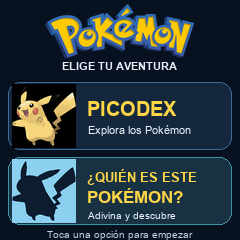

# Waveshare PICODEX + ¿Quién es este Pokémon?

An offline Pokémon toy for the **Waveshare RP2350-Touch-LCD-1.54**, running
MicroPython 1.29. The five-second Pokémon/Poké Ball `Loading....` splash opens
an illustrated landing page with two choices:

- **PICODEX:** browse the existing 1,538 static artwork entries and Spanish descriptions.
- **¿Quién es este Pokémon?:** guess a random silhouette, tap to reveal its original
  artwork and name, then tap again for a different question.



Both cards reuse the existing Pikachu artwork. All 1,538 entries, including
alternate forms, have matching silhouettes derived from that same archive.
The original artwork SD card is reused unchanged. Only the Poké Ball startup
and shutdown screens animate; Pokémon artwork remains static.
There is no Virtual Pokemon app, battery percentage or charging popup.

## Controls

### Landing page

Tap either illustrated card. You can also short-press the **left button** to
open PICODEX or the **right button** to open the guessing game.

### PICODEX

- Tap the left/right third of the artwork, or short-press the corresponding
  hardware button, for the previous/next Pokémon.
- Hold the centre of the artwork for about one second to read its description.
- Tap a description to advance; tap its final page to return to identical artwork.
- Hold the right button for two seconds to return to the first Pokémon.
- Move gently to choose a different random entry. Let the device settle before
  shaking again; continuous movement does not repeatedly change it.

### Guessing game

Think of or say the Pokémon's name, then **tap to reveal** its original artwork
and name. **Tap again for another silhouette.** Either hardware button, short
pressed, performs the same action. The `OTRO >` label also indicates the next
question after a reveal. Movement does not change the question, and holding the
image does not open descriptions while playing.

### Home and power

- Tap **INICIO** at the top centre of an artwork or silhouette to return home.
- Hold **both buttons together for 0.6 seconds** to return home from any page,
  including a description. Release both before choosing a new mode.
- Hold the **left button alone for 1.5 seconds** to play the animated `GOODBYE!`
  screen and switch off on battery. USB may keep the chip powered after the
  screen goes black.

PICODEX remembers the last browsed entry while switching modes. A new power-on
starts at the landing page, with PICODEX ready at its first entry.

## Files and manual installation

This project derives from
[persanz/waveshare-pokemon-frame](https://github.com/persanz/waveshare-pokemon-frame).
Use **MicroPython 1.29, mpy format v6.3**, on the specified Waveshare board.
The precompiled `.mpy` modules are included; application `.py` sources belong on
your computer, because source files on the device shadow compiled modules and
can use too much memory.

Keep the existing FAT-formatted SD card, with this file at its card root:

```text
/waveshare_pokemon_frame/pokemon_hd.dat
/waveshare_pokemon_frame/quiz.dat
```

Copy the included `quiz.dat` beside the existing artwork archive, using an
SD-card reader. The firmware mounts the card as `/sd`. Preserve other SD-card folders and personal
files. You do not need to reformat or replace the artwork archive.

Copy these files to the **board's internal filesystem root**:

```text
boot_splash.mpy
boot_splash.dat
pokeball.mpy
pokeball.dat
landing.dat
lcd.mpy
frame_app.mpy
pokemon_footer.mpy
dex_description.mpy
shutdown_screen.mpy
sdcard.mpy
pokemon_order.bin
pokemon_dex.bin
pokemon_descriptions_es.bin
main.py                       # activate LAST
```

`quiz.dat` is about 3.8 MiB and belongs on the SD card, alongside the original
artwork. `landing.dat` is 115,200 bytes and belongs in internal flash. Keeping
quiz decoding on the SD card avoids the larger internal-filesystem cache while
the LCD buffer is allocated. Keep the working `lcd.py` driver if already present;
its API matches the supplied compiled driver.

For manual copying with [Thonny](https://thonny.org/):

1. Download/extract this repository on your computer. Connect the board by USB,
   select the MicroPython (Raspberry Pi Pico) interpreter and the board's port.
   The BOOTSEL/UF2 drive is for firmware, not these application files.
2. Choose **View → Files**. Download backups of `main.py`, `frame_app.mpy` and any
   device files you will replace before uploading changes.
3. Stop the running application and immediately paste this maintenance command
   in Thonny's Shell. It holds battery power on and resets the chip to clear the
   existing eight-second watchdog before large transfers:

   ```python
   import os, machine; f = open('main.py', 'w'); f.write("from machine import Pin\nPin(28, Pin.OUT, value=1)\nprint('Maintenance mode')\n"); f.close(); os.sync(); machine.reset()
   ```

4. Wait for `Maintenance mode`. Use Thonny's file panel to upload the listed
   files to the device root, with the repository's **`main.py` last**. Compare
   file sizes after copying. For a verified staged installation, upload with
   temporary names, check SHA-256 hashes and rename into place, main last.
5. Run `machine.reset()` in the Shell. Expect the animated five-second splash,
   then the illustrated landing page. Select each mode to check it.

For command-line transfers, identify the port with
`uv tool run mpremote connect list`; back up, enter maintenance mode and use
`mpremote fs cp`. A hardware reset clears an active watchdog; a soft reset alone
is insufficient for long uploads. Stage and checksum files before activation.
The old launcher/companion modules, if present, are unused and can remain.

## Build and validation

Rebuild the host-generated assets:

```sh
uv run --no-project --with pillow python build_pokeball.py
uv run --no-project --with pillow --with resvg-py python build_boot_splash.py
uv run --no-project --with pillow --with numpy --with scipy --with resvg-py python build_quiz.py
```

`build_quiz.py` uses only the existing RGB565 archive. It fills interior dark
areas and closes tiny gaps to form solid silhouettes; the source archive has no
alpha channel, so very dark outlines and fine details are approximated.
Unicode labels are rendered on the host. On hosts without Arial/DejaVu Sans,
set `PICODEX_FONT` and `PICODEX_FONT_BOLD` to suitable TrueType font paths.

Compile matching modules and validate assets:

```sh
for module in boot_splash pokeball lcd frame_app pokemon_footer dex_description shutdown_screen sdcard; do
  uv tool run --from mpy-cross mpy-cross "$module.py"
done
python3 -m unittest discover -s tests -v
python3 validate_assets.py
python3 validate_quiz.py
```

`main.py` remains source. Rebuild the Spanish description database with
`python3 build_descriptions.py` if its included JSON changes.

The archive format is a 32-bit count followed by 16-byte entries
`(art_id, offset, compressed_size, name_offset)`. Each body expands to 115,200
bytes of big-endian RGB565 using raw DEFLATE with a 1 KiB window. `quiz.dat`
uses the same format and entry order. `pokemon_order.bin` maps displayed order
to archive indices; alternate-form IDs map through `pokemon_dex.bin`.

## Memory and hardware checks

The 115,200-byte LCD framebuffer leaves little heap. `gc.threshold(1024)`,
compiled modules and streaming decode are important. Landing artwork loads into
that existing buffer, and silhouettes use the same SD-backed row decoder as
the artwork. The name/footer renderer loads only after decoding has finished
and its buffers have been released, then unloads before the next image.
No second framebuffer, runtime image transformations or network access is needed.
Description return uses a flash snapshot instead of decompressing the artwork
again. Touch and IMU share I2C1 with a 50 ms timeout; power handling runs before
touch processing. The display uses byte-swapped RGB565, e.g. red `0x00f8`.

Hardware scripts in `tests/hardware_*.py` run simulated input on a real LCD/SD
card. Compile/upload them as `.mpy` before importing. They exercise mode
selection, answer reveal, next questions, motion isolation, home return,
remembered PICODEX entries, identical description return and shutdown handling.
Verified on the connected board: two quiz rounds, remembered PICODEX selection,
identical description return, button-only home/game navigation and animated
shutdown even with injected touch failures. The combined instrumented flow
finished with 4,560 bytes free. All 1,538 artwork and silhouette records also
passed host validation.

Physical touch feel and battery cutoff still require owner handling; host tests
do not replace physical checks.

## Splash, sources and rights

The supplied [Poké Ball GIF by Zel-Duh](https://www.deviantart.com/zel-duh/art/Pokeball-349366267)
retains its 15 frames and original timing, streamed for five seconds at startup
and 1.5 seconds at shutdown. Both animation files belong in internal flash.
The player unloads before the app starts. Missing/damaged animation is logged;
shutdown retains a procedural fallback. See `assets/splash/SOURCES.md`.

Pokémon artwork and names originate from PokeAPI's official-artwork collection.
The quiz and landing artwork derive from that existing material; no additional
artwork source is required. Spanish translation provenance remains in the
included JSON. Pokémon names, artwork and trademarks belong to their respective
owners; Zel-Duh retains rights to the supplied GIF. No new license grant is
asserted over upstream material. SD and display drivers retain their notices.
